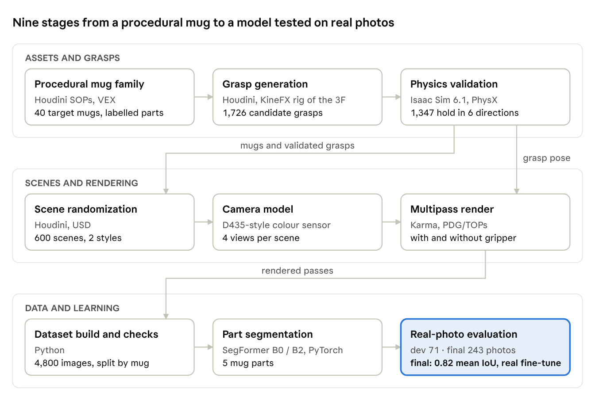

# Synthetic data for robotic grasping

A procedural, physics-checked synthetic data pipeline — Houdini → Isaac Sim → Karma — for part-level segmentation of mugs, evaluated on real photos.

**Final test (243 real photos of 61 mugs never seen in training; 5 wide-angle photos are reported separately):**

| Training data | Model | mIoU (5 mug parts) | Mug vs background IoU |
| --- | --- | --- | --- |
| Synthetic only | SegFormer-B2 | 0.60 | 0.77 |
| 71 real photos only | SegFormer-B2 | 0.67 | 0.74 |
| **Synthetic + the same 71 real photos** | SegFormer-B2 | **0.82** | **0.93** |

Synthetic pre-training makes a small real set go much further, and it is stable across seeds (0.815 / 0.816, against a 0.09 spread for real-only). Synthetic data alone does not beat real data yet: the gap concentrates on the handle. Glass fails for every model: transparent objects are rare in the synthetic set (only in the randomized style, about one in ten, with random tint and roughness) and realistic-style mugs are always ceramic. The full story, including a hypothesis that was tested and rejected, is in the [technical report](#links).

## What the pipeline does



1. **Procedural mug family** (Houdini SOPs, VEX). 40 target mugs with part labels — body, handle, rim, interior, base — written into the geometry, plus a physics version (mass, centre of mass) for simulation.
2. **Grasp generation** (Houdini, KineFX rig of a Robotiq 3F). Candidate grasps filtered by reach, contacts, opposition, collisions along the approach path and force closure.
3. **Physics validation** (Isaac Sim 6.1). Each grasp is closed on a free mug and pushed with 1–16 × its weight in six directions; 1,347 of 1,726 hold in all six.
4. **Scene randomization** (Houdini, USD). Table, distractors, materials in two styles, 20 HDR environments with random rotation and exposure.
5. **Camera model.** RealSense D435-style colour sensor, 1280 × 720, field of view 60–78°, four views per scene, depth of field on 30 % of views.
6. **Multipass render** (Karma, PDG/TOPs). RGB, depth, instance, class, mug-part ids and normals, each view with and without the gripper in its validated grasp pose.
7. **Dataset build and checks** (Python). Exact-id masks, OpenCV camera metadata, automatic checks on every image, splits by target mug.
8. **Segmentation** (PyTorch, SegFormer B0/B2) and **evaluation on real photos** with a dev / final protocol: decisions on dev, final test run once.

## Repository layout

| Path | What it does |
| --- | --- |
| **houdini/vex/01_assets/** | |
| `profile_curve.vfl` | Lathe profile of the mug body |
| `handle_generator.vfl` | Procedural handle (shape families, thickness, attachment) |
| `handle_label.vfl`, `part_label.vfl` | Part labels written into the geometry (body, handle, rim, interior, base) |
| `normalize_base.vfl`, `mug_metrics.vfl`, `wall_probe.vfl` | Base at y = 0, mug measurements, wall thickness probe |
| **houdini/vex/02_grasps/** | |
| `wrist_align.vfl` | Samples gripper poses around the mug |
| `path_check.vfl` | Collision check along the approach path |
| `robotiq_close.vfl` | Closes the Robotiq 3F fingers onto the mug |
| `grasp_contacts.vfl` | Finds contacts and zones (rim, body, handle, base) |
| `affordances.vfl`, `mug_info.vfl` | Task labels per grasp (lift, pour, place, handover) |
| `link_collision_prep.vfl`, `mesh_rigid_deform.vfl` | Gripper collision geometry and posing |
| **houdini/vex/03_scenes/** | |
| `scene_params.vfl`, `scene_layout.vfl`, `distractor_gen.vfl`, `mug_instances.vfl`, `table_ids.vfl` | Scene layout, distractors, instances |
| `place_gripper.vfl` | Places the gripper in its validated grasp pose |
| `appearance.vfl`, `mug_uv.vfl` | Materials, textures and UVs, two styles |
| `semantic_ids.vfl` | Instance, class and part ids for the render passes |
| `camera_views.vfl` | Camera model, framing and occlusion check |
| **houdini/python/** | |
| `01_mug_json.py`, `01_profile_style_top.py` | Mug physics data (mass, centre of mass); profile styles per mug (TOPs) |
| `02_urdf_skeleton.py` | Gripper skeleton from the URDF |
| `02_gws_check.py` | Force closure in the grasp wrench space |
| `02_grasp_export.py` | One JSON per grasp sample |
| `03_pick_grasp.py`, `03_scene_json.py`, `03_make_render_dir_top.py` | Picks a validated grasp per scene, writes scene.json, render folders |
| **isaac/** | |
| `grasp_physics_test.py` | Graded hold test of one or many grasps in Isaac Sim |
| `family_run.py` | Runs the test over a mug family |
| `merge_physics_results.py` | Writes physics labels back into the grasp JSONs |
| `label_count.py` | Lists which geometric labels to send to physics |
| **pipeline/** | |
| `mug_textures.py` | Procedural print textures for the mugs (UDIM) |
| `image_metadata.py` | Camera metadata, grasp keypoints and checks per render |
| `build_dataset.py` | EXR + metadata to the final dataset, splits by mug |
| `real_masks.py` | Real-photo polygon annotations to part masks |
| **training/** | |
| `train_seg.py` | SegFormer training and evaluation (synthetic, real, fine-tune) |
| `final_table.py` | Final-test table from the saved metrics |
| `real_diag.py`, `handle_view_stats.py` | Diagnostics used in the handle investigation |
| **tools/** | |
| `overlays.py`, `export_passes.py`, `isaac_clip_candidates.py` | Figures and video material |
| `export_houdini_code.py` | Exports the VEX and Python from a .hip into this layout |
| `export_hf_sample.py` | Exports the Hugging Face sample (Parquet, dataset card, preview grid) |

## Reproducing

Requirements: Houdini 22, Isaac Sim 6.1, Python 3.11 with `requirements.txt`, a CUDA GPU (developed on an RTX 3060 Ti, 8 GB, Windows 11).

The `.hip` files are not included: `houdini/` holds the code of every hand-written node (VEX wrangles, Python SOPs, TOP scripts), each with its node path and inputs in the header, in pipeline order. The commands below are for Windows `cmd`; every script also documents its options in its header.

```bat
git clone https://github.com/ivanpaguay/synthetic-mug-grasping
set REPO=C:\path\to\synthetic-mug-grasping
set SYNTH_ROOT=C:\path\to\data
set ROBOT=C:\path\to\robotiq_3f.usda
```

The gripper model is not redistributed: see `gripper/README.md`. `%SYNTH_ROOT%\HIPS` is the Houdini project folder (`$HIP`).

**1 · Mug family and grasps (Houdini).** The mug TOP network (`01_*`) writes `mugs/mug_XXXX/` (render and physics meshes, `mug.json`); the grasp network (`02_*`) writes one JSON and one posed-gripper geometry per grasp sample to `grasp_data_E/`.

**2 · Physics validation (Isaac Sim).** From the Isaac Sim folder:

```bat
python.bat %REPO%\isaac\label_count.py %SYNTH_ROOT%\HIPS\grasp_data_E
python.bat %REPO%\isaac\family_run.py --script %REPO%\isaac\grasp_physics_test.py --robot %ROBOT% ^
    --data %SYNTH_ROOT%\HIPS\grasp_data_E --out %SYNTH_ROOT%\HIPS\isaac_family_E --tag fam_E
python %REPO%\isaac\merge_physics_results.py --data %SYNTH_ROOT%\HIPS\grasp_data_E ^
    --results %SYNTH_ROOT%\HIPS\isaac_family_E\isaac_results_fam_E.json ^
    --out %SYNTH_ROOT%\HIPS\grasp_data_E_physics --primary fam_E
```

**3 · Textures, scenes and render.**

```bat
python %REPO%\pipeline\mug_textures.py --out %SYNTH_ROOT%\HIPS\textures --count 200
```

Then cook the scene TOP network (`03_*`) in Houdini: it picks a physics-validated grasp per scene from `grasp_data_E_physics\dataset_index.csv`, writes `scenes/scene_XXXXXX/scene.json` and renders every view with and without the gripper to `renders/` (Karma, husk).

**4 · Dataset build.** From the Isaac Sim folder (its Python has the EXR dependencies):

```bat
python.bat -m pip install OpenEXR
python.bat %REPO%\pipeline\image_metadata.py --hip %SYNTH_ROOT%\HIPS --grasp_dir %SYNTH_ROOT%\HIPS\grasp_data_E ^
    --scene_min 10000 --scene_max 13914 --summary metadata_summary_E.csv
python.bat %REPO%\pipeline\build_dataset.py --hip %SYNTH_ROOT%\HIPS --out %SYNTH_ROOT%\HIPS\dataset_E ^
    --val_mugs 103,104,105,106,124 --test_mugs 107,108,109,112,136 --scene_min 10000 --scene_max 13914
```

**5 · Real photos.** Annotate with X-AnyLabeling (polygons per part), then convert the dev and the final-test folders:

```bat
python.bat %REPO%\pipeline\real_masks.py --annotate %SYNTH_ROOT%\real_photos\annotate
python.bat %REPO%\pipeline\real_masks.py --annotate %SYNTH_ROOT%\real_photos\annotate_final
```

This writes `real_test` (dev, 71 photos) and `real_test_final` (final test, 248 photos).

**6 · Training and evaluation.** Each configuration is trained with `--seed 0` and `--seed 1`; the commands show seed 0.

```bat
cd %REPO%\training
set DEV=%SYNTH_ROOT%\real_photos\real_test
set FINAL=%SYNTH_ROOT%\real_photos\real_test_final

rem synthetic only (kept: best synthetic val)
python train_seg.py --data %SYNTH_ROOT%\HIPS\dataset_E --real %DEV% --out runs\E_b2 ^
    --model nvidia/mit-b2 --iters 32000 --batch 4
rem 71 real photos only (kept: last iteration)
python train_seg.py --train_real %DEV% --out runs\R_b2_s0 --model nvidia/mit-b2 ^
    --iters 6000 --batch 4 --select last --seed 0
rem synthetic pre-training + the same 71 photos
python train_seg.py --init runs\E_b2\best.pt --train_real %DEV% --out runs\FT_b2_s0 ^
    --model nvidia/mit-b2 --iters 3000 --batch 4 --lr 2e-5 --select last --seed 0

rem final test, once per model, then the table
python train_seg.py --init runs\FT_b2_s0\best.pt --eval_only 1 --real %FINAL% ^
    --out %SYNTH_ROOT%\train\final\FT_b2_s0 --model nvidia/mit-b2
python final_table.py --dir %SYNTH_ROOT%\train\final
```

B2 at batch 8 does not fit in 8 GB of VRAM (it spills into system memory and runs about twelve times slower): use batch 4.

## Data values kept in Spanish

The code and comments are in English. A few string values written into the data are kept in Spanish so the code reproduces the released files exactly:

| Where | Value | Meaning |
| --- | --- | --- |
| `aff_tasks` | `ninguna` | no task |
| `aff_*_reason` | `muestra_no_utilizable` | sample not usable (invalid grasp or blocked approach) |
| | `dedo_dentro_de_la_taza` | a finger inside the mug |
| | `boca_tapada` | mouth blocked |
| | `borde_sin_sector_libre` | no free arc of the rim for pouring |
| | `contacto_en_borde`, `dedo_cerca_del_borde` | contact on / finger near the rim (older rule) |
| | `sin_asa` | no handle contact (only when pouring requires the handle) |
| | `contacto_en_base`, `dedo_cerca_de_base` | contact on / finger near the base |
| | `sin_zona_libre_para_receptor` | no free zone for the receiver's hand |
| `aff_handover_via` | `asa`, `franja_superior`, `franja_inferior` | via the handle, the upper band, the lower band |
| mug attributes | `asa_*`, `perfil_version` | `asa` = handle, `perfil` = profile |
| `real_mugs*.csv` column | `foto` | photo (`photo` is also accepted) |

## Evaluation protocol

- **Dev set:** 71 real photos of 23 mugs — every decision. **Final test:** 248 photos of 61 other mugs — evaluated once, on a model list fixed in advance.
- **Metrics:** IoU per part and their mean (mIoU), mug-vs-background IoU; a 2 px band along annotated edges is excluded, strict scores are reported too.
- **Controls:** two seeds per configuration; ablations compared with random subsets of the same size.

## Limitations

One object family, one gripper, one phone and photographer for the real photos; almost no glass in the synthetic set; the handle remains the hardest part for synthetic-only training. See the report for details and next steps.

## Links

- Technical report: [docs/technical_report.pdf](docs/technical_report.pdf)
- Demo reel: *link to come*
- Dataset sample (Hugging Face): [ivanpaguay/synthetic-mug-grasping-sample](https://huggingface.co/datasets/ivanpaguay/synthetic-mug-grasping-sample) — 300 images in pairs without / with the gripper, all passes, CC BY-NC 4.0

## Licence and credits

Code under the MIT licence (`LICENSE`). The Robotiq 3F model comes from the ROS-Industrial `robotiq` package (BSD) and is not included. SegFormer via Hugging Face Transformers.

Author: Iván Paguay ([@ivanpaguay](https://github.com/ivanpaguay)) — synthetic data and simulation for robotics, 15 years as a VFX FX technical director.
